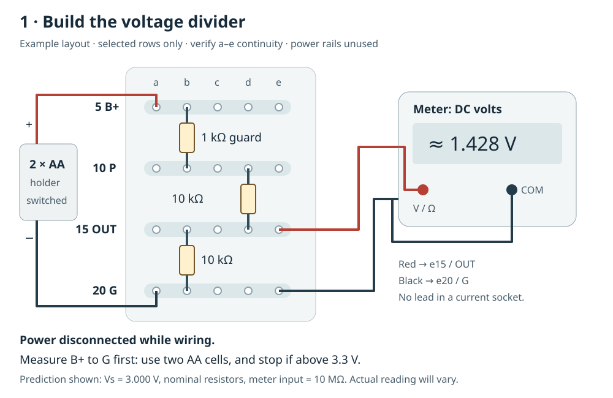
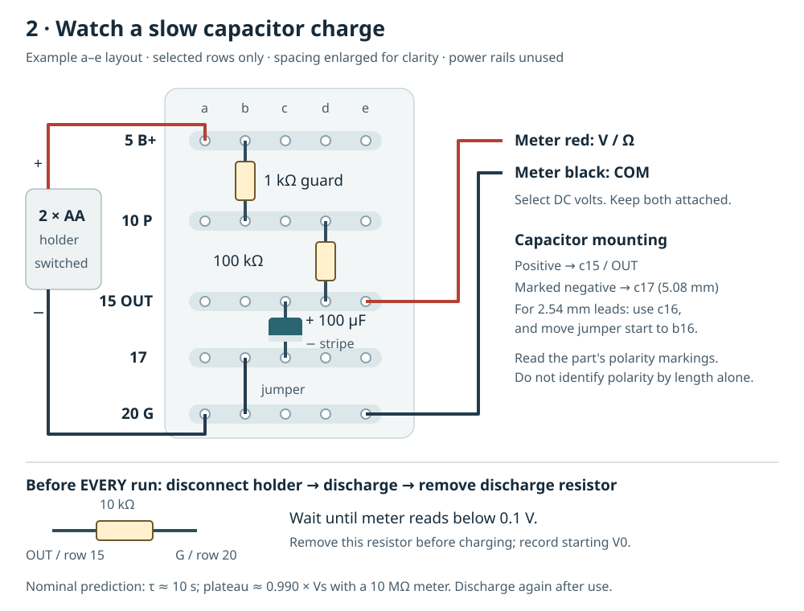
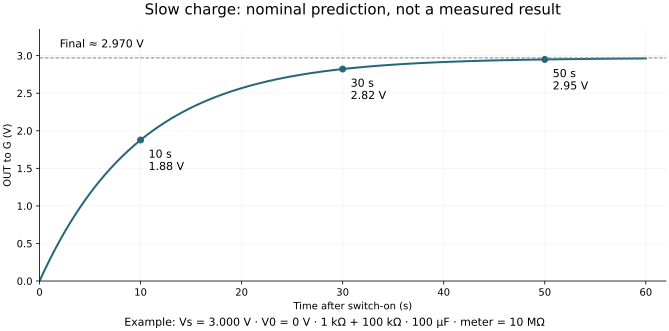

# First breadboard session: a divider, then a slow capacitor

2026-10-15. The user currently has no equipment at this house. This is a small,
standalone learning circuit powered by two AA cells. It has no connection to
either Rev A board, USB, a person, electrodes or mains. Buying this basic kit does
not depend on the Rev A PCB release. No purchase or supplier message was made.

## Small shopping list

| Quantity | Buy / required specification | Purpose |
|---:|---|---|
| 1 | Battery-powered digital multimeter with test leads and its own batteries, DC volts, resistance and continuity; documented nominal DC input 10 Mohm or higher on the selected range, at least 1 mV resolution around 3 V and DC accuracy about 1% or better including counts | The main reusable instrument; no computer connection needed |
| 1 | Good solderless breadboard, 400 or 830 tie points, 2.54 mm pitch, marked rows | 400 points is enough; check split power rails with the meter |
| 1 set | Pre-cut solid-core breadboard jumpers or male-to-male jumpers with breadboard-sized pins | Use ready-made lengths; no soldering or wire stripper required for this session |
| 1 + 2 | Switched two-AA holder and two matching alkaline AA cells; holder leads with ready-made insulated connection to breadboard-sized pins | About 3 V; do not substitute lithium cells or a 9 V battery |
| 5 each | Through-hole axial 1 kohm, 10 kohm and 100 kohm resistors, 1%, >=0.25 W | Includes spares; no tiny surface-mount resistor kit |
| 2 | Through-hole radial 100 uF electrolytic capacitors, >=16 V, +/-20%, clearly marked negative terminal, leads fitting 2.54/5.08 mm breadboard spacing | Slow visible charging; one spare. Leakage affects the result |
| 1 pair | Insulated mini-grabber test-lead adapters suitable for the meter's leads | Keep voltage contacts fixed while timing; do not jam oversized probes into sockets |

Choose a meter with a real manual specifying the selected DC range's impedance,
resolution and accuracy. The [UNI-T UT139 series](https://meters.uni-trend.com/product/ut139-series)
includes the UT139C example below. The advertised best DC accuracy does not apply
to every range. Check the exact model/range manual before buying; no seller, local stock, price
or authenticity has been verified. True RMS, Bluetooth, high current and transistor
test features are unnecessary for these two exercises. Prefer a legitimate
seller and included intact leads over a large anonymous accessory bundle.

No oscilloscope, bench supply, signal generator, ADC, microcontroller, soldering
station or PCB order is needed for this session. Later Rev A commissioning needs
the source/probes and simultaneous observations specified in B2; this meter alone
cannot qualify startup transients. Obtain that equipment after the actual test
setup is chosen, or use a suitably equipped lab/assembly service.

### Concrete meter example: UT139C

This is a checked example, not confirmation of the user's ordered model.
UNI-T's [manual P/N 110401104199 (manufacturer-authored distributor copy)](https://elexbrno.cz/dldfile.php?id=7423),
printed pages 7-9 and 16, specifies:

| Setting or specification | For these two exercises |
|---|---|
| Leads | Black in COM; red in V/ohm/Hz |
| Voltage mode | V position; SELECT if needed until the display indicates DC |
| Range | Short RANGE presses select manual 6 V; confirm V units, three decimal places and no Auto Range indicator |
| Reading modes | HOLD, REL and MAX/MIN off |
| Selected-range specification | 1 mV resolution; nominal 10 Mohm input; +/- (0.7% of reading + 3 counts) |
| Meter power | Two AA cells, separate from the holder's two cells |

Keep the manual 6 V range throughout charging; range changes otherwise complicate
comparison. At a displayed 1.428 V, the listed meter-only accuracy is about
13 mV, under the manual's one-year, 23 +/- 5 C, below-75%-RH conditions. This
excludes resistor/source uncertainty and is not a circuit pass band or calibration.
Confirm the actual unit's manual; other models/ranges can differ.

Source checked 2026-10-15; PDF SHA256
`81d4d00e65b2e138a664982ea67171aa07b27c6ae128859e4378e5dccf6911f4`.
The manufacturer's [download page](https://meters.uni-trend.com/download/ut139a-b-c-user-manual/)
is the current manual entry point; its PDF endpoint was unavailable during this check.

## Before inserting the batteries

Use continuity to map the empty board: typically each five-hole row is connected,
the centre channel separates the two halves, and long power rails can be split.
Do not assume matching red/blue lines imply continuity. Adafruit's
[breadboard guide](https://learn.adafruit.com/breadboards-for-beginners/breadboards)
and [split-rail explanation](https://learn.adafruit.com/breadboards-for-beginners/breadboard-tips-and-tricks)
show these arrangements. Our circuit only needs a few verified rows; no rail
bridges are required if rows are used as labelled nodes instead.

Measure each resistor loose and record it. Use black lead in COM and red in V/ohm,
never a current socket for these exercises. Resistance/continuity is for the
disconnected, discharged circuit only. Keep the unused battery lead insulated;
AA cells can deliver substantial current into a direct short.

Assign four separate rows as **B+**, **P**, **OUT**, and **G**. The holder positive
goes to B+; holder negative goes to G. A 1 kohm resistor from B+ to P is present
in BOTH exercises. It limits a downstream short to about 3 mA at 3 V, but cannot
protect a short between battery leads upstream of that resistor. Secure the
holder/contacts so loose metal cannot bridge them. Switch off and disconnect the
holder before rewiring; keep the two cells out until the first circuit is checked.

## Exercise 1: predict and measure a voltage divider



The drawing uses the **a–e half** of rows 5, 10, 15, 20 as B+, P, OUT, G. Only those
rows are drawn; the intervening rows still exist on your board. Verify each
five-hole strip and its separation from the other rows before using this example.
The opposite half and power rails are unused. Connect holder+ to a5, holder− to
a20, the guard from b5 to b10, the top 10 kohm from d10 to d15 and the bottom 10 kohm
from b15 to b20. Meter contacts go to e15 and e20 using suitable jumper pins and
insulated grabbers. Do not insert oversized probes directly into the holes.

Wire this circuit, with the two leads of each resistor in different rows:

```text
holder + -- B+ -- 1k -- P -- 10k -- OUT -- 10k -- G -- holder -
                                      |          |
                                 meter red   meter black
```

With the holder disconnected, verify the resistor path and that no jumper
bypasses a resistor. Install the two cells, select DC volts, then turn on the
holder. Measure the actual B+-to-G voltage Vs first; it should be around 3 V
(do not proceed with a supply above 3.3 V). Then measure OUT-to-G.

With measured resistors Rguard, Rtop, Rbottom and meter input Rmeter:

```text
Rlower = 1 / (1/Rbottom + 1/Rmeter)
Vout = Vs * Rlower / (Rguard + Rtop + Rlower)
```

For nominal resistors, Vs=3.000 V and Rmeter=10 Mohm, Vout=**1.4278 V**;
the ratio is **0.475941**, not one half, because the 1 kohm guard is included.
As an independent check, current through the top 11 kohm equals current through
the bottom 10 kohm plus the meter input. If the lower resistor is missing, the
predicted meter reading is near Vs (0.998901*Vs); an OUT-to-G short reads near
zero. These are troubleshooting predictions, not instructions to make shorts.

Record Vs, the three resistance readings, meter model/range and measured Vout.
Compare against the formula including the manual's reading/count uncertainty
and resistance-measurement uncertainty. A rough 1.4 V reading at 3 V is a useful
first check; a discrepancy is a reason to switch off and inspect rows/values,
not adjust the formula. Do not call this calibration of the meter.

## Exercise 2: watch a slow charge and discharge



Disconnect the holder. Remove both 10 kohm divider resistors. Put 100 kohm
between P and OUT, and the 100 uF capacitor between OUT and G: **positive at OUT,
marked negative at G**. Check polarity from the part marking/datasheet rather
than lead length alone. Keep the 1 kohm guard and DC meter in place.

In the example, the 100 kohm spans d10–d15. Put capacitor+ in c15 and its marked
negative lead in c17 for 5.08 mm lead spacing, then add a jumper b17–b20. For 2.54 mm
spacing, use c16 and jumper b16–b20 instead. This spare negative-lead row avoids
stretching a small capacitor across five rows. Both leads must occupy different
electrical strips; the negative row reaches G through the jumper. Use the actual
part's lead spacing without forcing its leads or body.

```text
holder + -- B+ -- 1k -- P -- 100k -- OUT
                                      |     meter red at OUT
                                    + 100uF
                                    - |
holder - -----------------------------G     meter black at G
```

Before **every run, including a repeat or interrupted run**, leave the holder
disconnected and the meter on DC volts. Discharge OUT to G through the separate
10 kohm resistor until the meter reads below 0.1 V; never use a wire short.
Remove that discharge resistor before connecting/enabling the holder, otherwise
it changes both the final voltage and time constant. Record the starting voltage
V0 immediately before switching on; repeat the discharge if it is >=0.1 V.

Turn on and record Vout around 0, 10, 30 and 50 seconds, plus the eventual steady
reading. A phone timer/video is sufficient; manual timing and meter refresh make
this an approximate observation. With ideal nominal parts and a 10 Mohm meter,
the time constant is `(101k || 10M)*100uF = 9.999 s` and the final voltage is
0.990001*Vs. At one/three/five time constants the ideal voltage reaches about
63.2% / 95.0% / 99.3% of its final value when V0=0. With a small nonzero V0,
use `V(t) = Vfinal + (V0 - Vfinal)*exp(-t/tau)`; those percentages then apply to
the rise from V0 toward Vfinal. Do not treat a partly charged start as zero.



The capacitor's tolerance, leakage and the meter alter the curve. These are
predictions, not a pass/fail specification for an unknown electrolytic. A low
plateau does not by itself prove a faulty part. Do not use this experiment to
infer the Rev A MLCC's capacitance under bias or validate its internal nodes.

Afterwards switch off and disconnect the holder. Discharge through a separate
10 kohm resistor from OUT to G, leaving the voltage meter connected; wait until
the reading is below 0.1 V before handling or rewiring. Never discharge by a
wire short. If anything warms, smells unusual or is wired with reversed polarity,
disconnect the holder and investigate before another attempt.

Use this small record in the same guide; leave unknown or unmeasured entries
blank. The graph above is an example, not a replacement for your actual readings.

| What to record | Your result |
|---|---|
| Meter model; DC range; manual input impedance/accuracy | |
| Loose resistor readings: guard / top / bottom / charging resistor | |
| Capacitor marking, tolerance and polarity identification | |
| Actual Vs: B+ to G | |
| Divider: predicted / measured OUT to G | |
| Before charge: discharged below0.1V; discharge resistor removed | |
| Starting V0; readings at10s / 30s / 50s / eventual plateau | |
| After use: holder disconnected; final discharge reading | |

Send that record for the next comparison with theory. The first practical
milestone is seeing these two passive circuits behave as predicted; EEG hardware
assembly and its existing safety/release gates remain separate.
